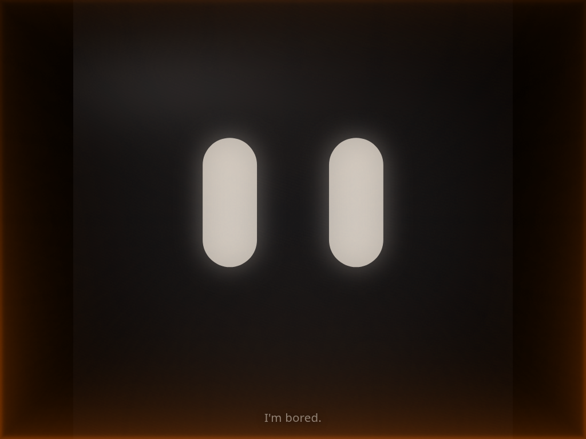
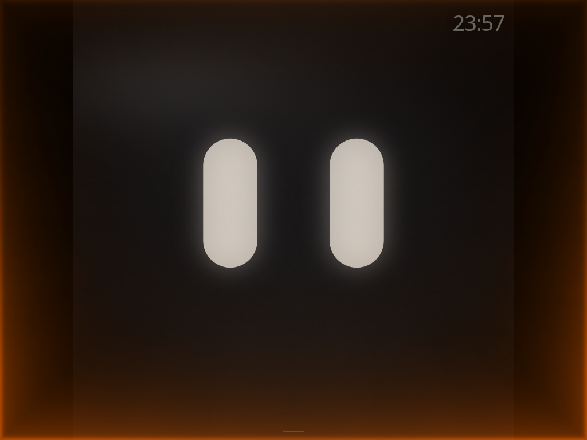

# Grok Bot Home Assistant UI

Help for the wall tablet. The same sections are linked from settings.

<h2 id="display">Display</h2>

The page is German or English. It follows the browser language until a saved choice, `config.local.json`, or `?lang=` overrides it.

Three themes share the view control. Bold (`vollbild`) is the default: the same eyes in high contrast, with no rounded outline. Colour shows only as a short glow when a tap is acknowledged, and that acknowledgement plays a sound. The red rim is added only while angry. Cube (`2d`, also `?mode=cube`) keeps the soft eyes and draws them in a square. The coloured cues stay at the screen edge, and the square has no frame. Fortune (`led`) is the LED preview inside a round frame. The tablet does not send the hardware buffer anywhere. The view control cycles Cube, Fortune, and Bold.

Cube and Fortune draw a living edge light. Lively is the default profile. Quiet is the other one (`licht_profil` `ruhig` or `lebhaft`, also `?light=`). Every state except angry uses that living edge, including speaking. Bold uses that light only for the short acknowledgement, and adds the red rim only while angry. Sleep stays calm and a little brighter than the design reference so it still reads. There is no grain.





Sleep is in minutes. `0` keeps the eyes awake. The page dims to 30 percent after 60 seconds of quiet (`dimAfter`, `dimLevel`). The inactivity sleep timeout does not use `dimLead`, so dimming does not start at once. `dimLead` is only the ramp before a scheduled sleep time of day. The clock is off unless you turn it on. iOS draws the status bar itself. This page cannot hide that bar in Safari or on the iOS 10 home screen, so the in-app clock stays off and does not repeat it. The clock sits clear of the corner tap area. Tap it for My day: a large clock, today’s events, and the small bot. Tap the empty area above the bot to leave. The state name, when enabled, sits under the clock. While the eyes sleep, the bottom line plays “Zzzzzz...” instead of a corner glyph. The status line is on until you turn it off. Now playing is on. Demo mode is on. Alarm intensity is Strong. `?alarm=normal` or `?alarm=strong` changes it for one visit, and `?alarm_intensity=` accepts the same words.

<h2 id="sound">Sound</h2>

The first tap anywhere unlocks sound. Nothing on screen asks for that tap. Idle and a glance stay silent. Every other state has its own tone. `hello` from Home Assistant plays the short greeting chirp and shows “Hi” on the bottom line, including when the status line is off. A Shortcut on another phone cannot unlock audio in Safari.

When the eyes are in the music state and no media player is set, the page plays Orbit Drift, an original loop made in the browser. The now-playing line reads “Orbit Drift, HVUZ Demo (2026)”. It fades in and out. The musical work is CC0. If a media player is set and that player is empty, unavailable, or unknown, the line stays hidden and the page does not report an error.

<h2 id="home-assistant">Home Assistant</h2>

The page talks only to the local WebSocket API. On your own device the token stays only in that browser's localStorage, under `eye_ui_config`, and is never put in a URL or sent anywhere except your Home Assistant. On the public demo host no token is ever stored.

The usual names are `input_select.eye_ui_state`, `script.eye_music_on`, `script.eye_music_off`, `script.eye_light_on`, and `script.eye_light_off`. The media player, the door contact, and the camera start empty. A door entity such as `binary_sensor.front_door` wakes the eyes with a short original chirp when it opens. A camera entity such as `camera.courtyard` is the preview in the home detail. A script entity is called as a script. A value such as `light.toggle/light.hallway` is a service plus a target.

`?ha=mock` plays states on this device without a server.

`listening` keeps the listening look until the next state. `music_on`, or playback that starts after thinking or understood, opens music mode and the now-playing detail with no swipe. The music corner leaves that view. Playback that stays stopped for 20 seconds leaves it too. Under the transport buttons, Up next lists up to five entries when the player exposes a queue, a playlist list, or `source_list`. A tap calls `media_player.play_media` or `media_player.select_source`. The block stays hidden when there is nothing to show.

<h2 id="voice">Voice with an iPhone shortcut</h2>

The wall tablet draws the eyes. Voice needs a separate microphone device.

On the iPhone, make a Vocal Shortcut named “Hey Grok” and point it at a Shortcut. Vocal Shortcuts need iOS 18. Inside the Shortcut, the Home Assistant action “Perform action” calls `script.grok_hallo`. That action needs iOS 17. Dictate, then call `script.grok_spiel_musik` the same way.

`script.grok_hallo` sets `input_select.eye_ui_state` to `hello`. The eyes play the short greeting chirp and the bottom line shows “Hi”. `script.grok_spiel_musik` is the script for the dictated request. A music request can set `listening`, then `understood` or `thinking`, then `music_on`, and start the player. `listening` holds until the next option. `music_on`, or the player reaching `playing` after thinking or understood, opens the now-playing detail on its own.

Sound on the tablet still needs one tap in the page first. A Shortcut on the phone cannot unlock audio in Safari.

<h2 id="gestures">Gestures</h2>

Swipe left opens the quick sheet. While music or home mode is active, swipe right opens that mode’s detail, on a phone and on a tablet. Swipe up toggles the status line. Swipe down opens settings. A swipe up that starts at the bottom edge of the screen opens settings. That edge is fixed, so the swipe-up action still runs everywhere else. A long press on the eyes starts demo mode.

The music corner enters music mode and starts music. The same corner again returns to the normal view. The home action enters home mode the same way. Each action can do nothing, toggle music, toggle the lights, call a service, open settings, open the quick sheet, show or hide the clock, show or hide the status line, start and stop demo mode, cycle the theme, or enter home mode. A custom action is a label plus a service, for example `light.toggle/light.hallway`.

The left edge is still music on and off. The right edge is still lights on and off. A tap in the middle only wakes the eyes.

On a phone or tablet the keyboard list stays hidden. On a desktop, `1` through `0`, then `q w e r`, select the states. Arrow keys run the swipes. Space starts the demo, and starts it again to stop. `m` cycles the view. `i` opens settings.

<h2 id="corners">Corners</h2>

Each corner has a tap and a hold. Top-left tap calls `light.toggle/light.living_room` and the hold toggles the clock. Top-right tap toggles music and the hold cycles the theme. Bottom-left and bottom-right taps cycle the theme. Their holds do nothing until you assign them. The hit area is about 128 CSS pixels, plus the safe-area inset where the system has one. Advanced can change the size. While the corner section is open, the zones show for a moment. The corner glows briefly when it runs.

Five taps in the top-left corner, each within about 0.35 s and all inside 2 s, always open settings and do not run that corner’s tap. One tap waits, then runs the tap. Two, three, or four taps run the tap once. While the eyes are asleep, a tap or a hold wakes them with “Hi.” Five taps still open settings.

<h2 id="states">States</h2>

The state buttons preview that state on the small bot while settings are open: the pose, the color, the caption, and the sound. Play all loops the emotions, ends on music, and starts again after 30 seconds. Closing settings returns to the state the eyes had before, unless demo mode stays on.

Advanced can replace the English caption, the German caption, the edge color, and the sound. An empty field keeps the original. Reset states clears those overrides. The eye-motion formulas do not change.

When the state name is on, a small glyph sits under the clock, on a phone and on a tablet. It does not take taps. If the clock is off, only the glyph shows. Sleep is not a glyph: the bottom line plays “Zzzzzz...”. Music pulses a note. Thinking fades dots. Listening moves a short wave. The other states use a short word.

| Key | English | German | Meaning |
|---|---|---|---|
| idle | I'm bored. | Bin gelangweilt. | Waiting quietly. |
| hallo | Hi. | Hi. | Saying hello. |
| blicke | Just looking. | Ich schau nur. | Looking around. |
| zuhoeren | Listening… | Hör zu… | Listening for what comes next. |
| nachdenken | Thinking | Denke nach | Working on an answer. |
| verstanden | Got it. | Verstanden. | Showing that it understood. |
| erledigt | All done. | Erledigt. | Showing that the task is finished. |
| nicht_verstanden | Come again? | Wie bitte? | Asking for that again. |
| fehler | That broke. | Das ging schief. | Showing that something failed. |
| angry | Intruder? | Wer da? | Warning that someone may be at the door. A held glare, a red pulse, and a short tone. It holds until the next state. |
| schlafen | Going quiet. | Ich döse. | Resting until the next tap. |
| lachen | Ha. | Haha. | Laughing. |
| musik_an | Music on. | Musik an. | Starting the music. |
| licht_an | Lights on. | Licht an. | Turning the lights on. |
| licht_aus | Lights out. | Licht aus. | Turning the lights off. |

`angry` is an option on `input_select.eye_ui_state`. The page does not watch the door for the glare. While `input_boolean.eye_guard` is on, the door opening sets angry and the eyes hold that glare until the door closes. While the guard is off, the door opening sets hello. The door closing sets idle, and the eyes ease back with a short smile. Play all shows angry after the error state. The status line is “Intruder?” in English and “Wer da?” in German, and it pulses red. The lids stay lowered and slanted inward, the eyes stay narrow, and they scan from side to side without lifting. A lunge plays on entry, then a small twitch every few seconds. The red edge replaces Quiet and Lively only while angry. Cube and Fortune keep the living edge for every other state. Bold keeps it for the short acknowledgement and adds the red rim only while angry. The tone repeats a few times, then pulses quietly. Alarm intensity is Normal or Strong, and Strong is the default. `?alarm=` and `?alarm_intensity=` accept `normal`, `norm`, `strong`, and `stark`. Bold, Cube, and Fortune all draw it. The legacy build does too.

`speaking` is an option on the same entity. The eyes stay idle and the edge light uses the speaking profile. `?licht_zustand=sprechen` previews it.

```yaml
input_boolean:
  eye_guard:
    name: Eye guard

automation:
  - alias: Eyes when the door opens
    triggers:
      - trigger: state
        entity_id: binary_sensor.front_door
        to: "on"
    actions:
      - choose:
          - conditions:
              - condition: state
                entity_id: input_boolean.eye_guard
                state: "on"
            sequence:
              - action: input_select.select_option
                target:
                  entity_id: input_select.eye_ui_state
                data:
                  option: angry
        default:
          - action: input_select.select_option
            target:
              entity_id: input_select.eye_ui_state
            data:
              option: hello
  - alias: Idle eyes when the door closes
    triggers:
      - trigger: state
        entity_id: binary_sensor.front_door
        to: "off"
    actions:
      - action: input_select.select_option
        target:
          entity_id: input_select.eye_ui_state
        data:
          option: idle
```

<h2 id="security">Security</h2>

The optional settings lock is off by default. It stores a salted hash on this device and never the PIN or password. It is only a convenience lock, not real security. Anyone with the device can clear it by opening the page with `?lock=reset`. That parameter only removes the lock. It does not change the Home Assistant token.

On your own device the token stays only in that browser's localStorage. It is never put in a URL or sent anywhere except your Home Assistant. A saved token is kept when the page is updated. `config.local.json` can fill an empty token. That file is readable by anyone on the LAN, so use a non-admin, local-only Home Assistant user. On the public demo host no token is ever stored.

<h2 id="demo">Demo mode</h2>

Demo mode loops the emotions and reactions: hello, listening, thinking, understood, done, laugh, confused, angry, sleepy, glance, and error. It ends on music, holds that for 30 seconds, then starts again until you tap. It keeps moving in fullscreen and while an overlay is open. It does not change the theme and it does not open the music cover. Turn it on in settings, with Play all, or with a gesture or a corner. Turn it off the same way, or tap the eyes. If it is still on when you close settings, the tour continues. On the public demo host, the address, the token, the entities, and custom action text are read-only, with the note “disabled in the demo”.

A public demo is live at <https://grok-bot-ui.herrvonundzu.eu>. On that host no token is ever stored. On any other HTTPS page that has no Home Assistant address and no token yet, the tour starts on its own. There is no badge. While the corners are still the stock map, each one does something a visitor can find: settings, the next theme, music, and Home mode. On your own device the token stays only in that browser's localStorage. `?demo=1` forces the tour. `?demo=0` leaves the page idle so it can be set up.

<h2 id="phone">Phone and tablet</h2>

A touch screen whose shorter side is under 600 CSS pixels uses the phone profile. A larger touch screen, and every device without touch, uses the tablet profile. The two profiles are stored separately, and settings name the one open now. The profile line links to this section. Settings open as separate pages. On a phone the settings are full width on black. On a phone in portrait the eyes sit in from the left and right edges. On a tablet in landscape the shaded frame stays full size and only the eyes shrink.

<h2 id="requirements">Requirements</h2>

Tested on current iPadOS and against Home Assistant 2026.10.4.

The minimum system is iOS 10.3 / Safari 10.1.

Eyes and touch control keep working from iPad 4 / iOS 10.3.3, Safari 10.1: legacy build available, device test pending. Voice needs a separate microphone device.

These floors are per vendor store pages, Oct 2026:

- This page does not use the microphone. Voice goes through an iPhone Shortcut or the Home Assistant Companion app. `getUserMedia` is only what a future in-browser microphone would need: iOS/iPadOS 13.4 or newer as a Home Screen app, or Chrome 53 or newer on Android, and HTTPS or localhost.
- The Home Assistant Companion app needs iPadOS 16.4 or newer, or Android 6 or newer.
- The Grok Bot app needs iPadOS 18 or newer, or Android 9 or newer.
- A background wake word on a tablet is only possible on Android, with the Home Assistant Companion app as the default assistant. That path is experimental.

Over plain `http` on the LAN, the eyes, sound, gestures, and a `ws://` connection work. Wake Lock and the offline cache need HTTPS or localhost. Hosts should send `Cache-Control: no-cache` for `sw.js` and `index.html`. Add to Home Screen, set Auto-Lock to Never, and use Guided Access if the tablet should stay on this page.

The settings lock is only a convenience. There is no Grok client in this page. Simple commands go to Home Assistant. Real questions are handed on through your own Grok Bot setup.

<h2 id="dashboard">Home and Music detail views</h2>

Home mode keeps the eyes up. Swipe right opens Home: open contacts, Guard, and waste, plus weather and the calendar when those entities are set. A camera preview is there when a camera entity is set. Tap the preview to fill the screen, and tap again to close. `music_on`, or playback that starts after thinking or understood, opens Now Playing on its own. Under the transport buttons, Up next lists up to five entries when the player exposes a queue, a playlist list, or `source_list`. On Cube and Fortune, and on Bold, the open detail takes the left half. The eyes stay on the right. Swipe up or down on the left half moves through My day, Home, Energy, Climate, Music, Status, and Timer. Swipe left closes. A view appears only when its entities exist. Energy stays hidden until a PV entity is set and present. The timer is local and does not call Home Assistant. The small bot sits at the lower right.

The card can also show waste that goes out today or tomorrow, open windows, indoor temperatures, and outdoor rain, wind, and brightness. A tile is hidden when its entity is not set or is unavailable.

Waste can be a sensor such as `sensor.waste_paper` or a calendar such as `calendar.waste`. The calendar shows the next event per bin for today or tomorrow. The bin name comes from the event summary.

“All off” calls `script.eye_all_off`. “Guard on/off” calls `script.eye_guard_toggle` and shows `input_boolean.eye_guard`. More buttons can be added in settings, one `Label|service` line each.

`?ha=mock` and demo mode use sample data, including a closed front door and a courtyard camera. An optional `config.local.json` next to the page can set these entity ids, plus `door`, `camera`, `dimAfter`, `dimLevel`, `dimLead`, the address, and the token. `config.example.json` is the template. When the file sets an address, that address overrides the saved one. A token in the file fills an empty store. A token already saved on the device stays. Other saved settings still win. The file is readable by anyone on the LAN, so use a non-admin, local-only Home Assistant user. The public demo host ignores the address and the token from the file. Defaults apply first, then saved settings, then the file for the address and for a missing token, then URL parameters. The quick sheet ends with Demo. That tour loops the emotions, ends on music for 30 seconds, then starts again until the next tap.

<h2 id="credits">Credits</h2>

The page no longer has a credits button. The public project page must keep this id (`#credits`) so older links still land here.

Maintainer: stefanvr82.

The first idea of eyes on the wall: [a post by @Texas_Twins_Dad](https://x.com/Texas_Twins_Dad/status/2114196344025878632).

Source code: coming soon.

Support: coming soon.

About the maintainer: [HERRVONUNDZU, Digitalisierung & Automatisierung](https://www.herrvonundzu.eu/digitalisierung-automatisierung-4).

The page is MIT, except the HVUZ mark and the code of conduct. Orbit Drift is original and dedicated under CC0.

<h2 id="changelog">Changelog</h2>

See [CHANGELOG.md](../CHANGELOG.md). The version in the corner of settings links here.
